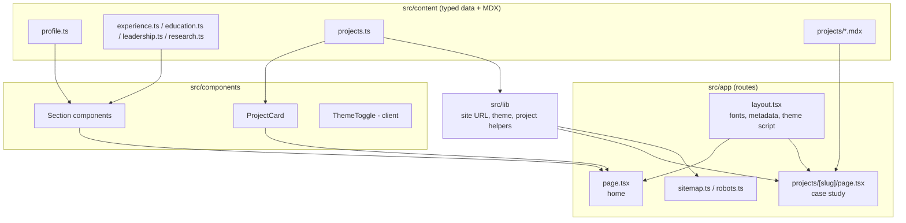

# Architecture

A static-first Next.js site. Content is data, components render it, and every page can be produced at build time. There is no database, no API and no server-side state.

## Overview

## Rendering model

| Route | Rendering |
|---|---|
| `/` | Static: assembled from typed content at build time |
| `/projects/[slug]` | Static: `generateStaticParams` returns the slugs of projects marked `caseStudy`; `dynamicParams = false` makes any other slug a 404 |
| `/sitemap.xml`, `/robots.txt` | Generated from the same content and the site URL |

Only `ThemeToggle` is a client component. Everything else renders on the server, which keeps the JavaScript sent to the browser small.

## Content model

Content lives in typed modules (`src/content/types.ts` defines the shapes). A project has a `kind` (`featured` or `supporting`) and a `caseStudy` flag. Featured projects have an MDX page at `src/content/projects/<slug>.mdx`. Tests enforce the relationships:

- slugs are unique;
- every `caseStudy: true` project has an MDX file, and every MDX file belongs to a project;
- featured projects are exactly the ones with case studies;
- repository links point at `github.com/Praneetha1844`;
- featured summaries contain no numeric performance claims.

## Theming

Colours are CSS variables on `:root` (light) and `:root[data-theme="dark"]`. Tailwind maps them to utility colours with `rgb(var(--token) / <alpha-value>)`. A small inline script in `<head>` sets `data-theme` before first paint from `localStorage` or the system preference, so there is no flash. See [ADR 0002](adr/0002-theme-via-css-variables-and-inline-script.md).

## Accessibility

- Skip link to `#main`; `header`, `nav`, `main`, `footer` and labelled `section` landmarks.
- One `h1` per page, then `h2` per section and `h3` per item.
- Visible `:focus-visible` outline on every interactive element.
- Links that open a new tab say so in visually hidden text and use `rel="noopener noreferrer"`.
- `prefers-reduced-motion` disables smooth scrolling and transitions.

## Metadata and SEO

`metadataBase`, OpenGraph and Twitter tags are set in `layout.tsx`; case studies add their own title, description and canonical path. The home page embeds JSON-LD `Person` data derived from the profile. The sitemap lists the home page and every case study.

## Security posture

- Static output: no runtime server code beyond what Next.js provides.
- Response headers: `X-Content-Type-Options`, `X-Frame-Options`, `Referrer-Policy`, `Permissions-Policy`.
- No third-party scripts, cookies or analytics ([ADR 0003](adr/0003-static-first-no-tracking.md)).
- No secrets: the only environment variable is the public site URL.

## Testing

Vitest with jsdom. Tests cover content integrity, the `ProjectCard` component (links, new-tab behaviour, tag list), the site URL helper, sitemap and robots output, and theme helpers including the pre-paint script. Visual and automated accessibility checks are not part of the suite yet.
